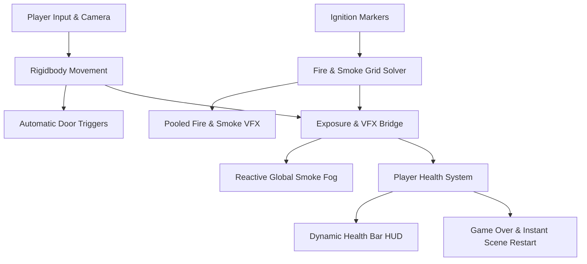

# Smart-Evac: Real-Time Fire & Disaster Simulation

A first-person emergency disaster simulation built in Unity. Players navigate an office maze as active fire and toxic smoke propagate dynamically across the level, testing real-time hazard awareness, exposure damage, and evacuation decision-making.

---

## Project Overview

Smart-Evac simulates the physical realities of an indoor structural fire. Unlike scripted game fires that simply sit in place, our environment features a live simulation grid where heat and smoke propagate through hallways, accumulate over time, and dynamically degrade air quality.

### Key Systems & Engineering Highlights

* **Dynamic Hazard Propagation**: A real-time grid simulation (325,000 cells) calculates continuous heat spread, fuel depletion, and two-layer smoke accumulation—tracking both the hot ceiling layer and suffocating lower air.
* **Physiological Damage & Exposure**: Hazards are sampled continuously at the player's exact coordinates. High temperatures cause severe burn damage while lower smoke induces choke damage, visually tracked by a reactive green-to-red health HUD.
* **Atmospheric Volumetric Fog**: Local smoke concentration dynamically drives scene-wide exponential fog density and color blending, realistically restricting visibility and disorienting the player as fire spreads.
* **Interactive Environment**: Built inside an expansive office maze featuring trigger-activated doors, dual-backend movement controls, automated ignition points, and an instant game-over/retry loop.
* **Optimized for Real-Time Performance**: Employs object pooling for fire and smoke particle effects to eliminate frame-rate stutter and garbage collection spikes.

### System Architecture Flow

---

## Controls

| Key / Input | Action |
| :--- | :--- |
| **W / S** | Move Forward / Backward |
| **A / D** | Strafe / Turn |
| **Mouse** | Look around (Mouse Mode) |
| **E** | Toggle Mouse Look Mode |
| **Ctrl / Shift** | Crouch |
| **R / Space** | Restart after death |
| **Restart Button** | UI click on Game Over to reload |

---

## Quick Start & Evaluation Guide

1. **Unity Version**: Built and verified for **Unity 6 (`6000.3.27f1`)** with Universal Render Pipeline (URP).
2. **Open Project**:
   * Open **Unity Hub** $\rightarrow$ Click **Add project from disk**.
   * Select the **`Disaster Management`** folder inside this repository.
3. **Run the Simulation**:
   * **`Assets/ScifiOfficeLite/Scene/Demo.unity`** is pre-configured as the primary default scene (Scene Index 0).
   * Press **Play** in the Unity Editor and click inside the Game view.

---

## Technical & Architecture Documentation
* [Technical Specifications](technical.md) – In-depth grid parameters, exposure thresholds, and component tuning.
* [System Architecture](architecture.md) – Detailed component lifecycle, state machines, and data flow.
