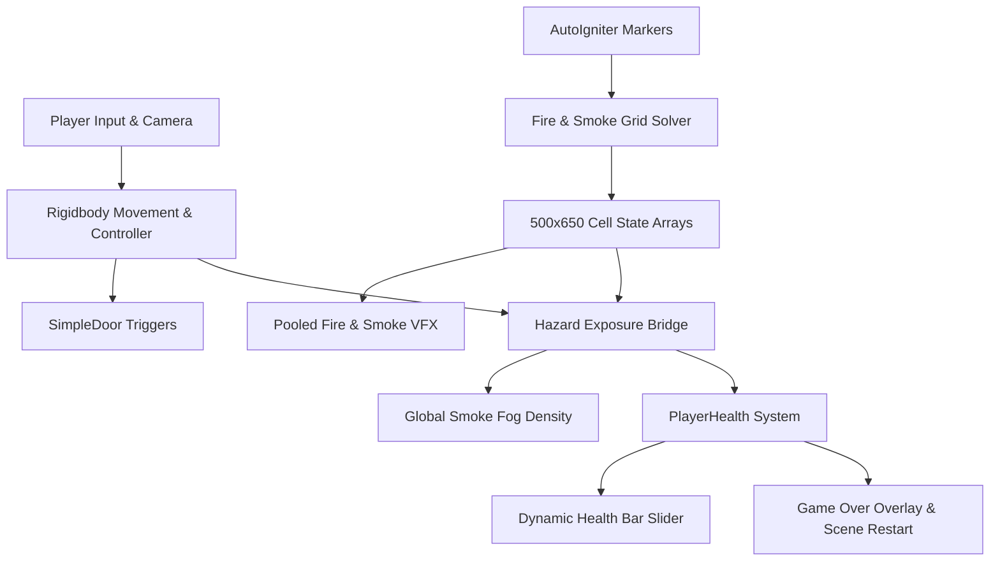

# Smart-Evac: Fire and Smoke Simulation

A Unity first-person disaster simulation set in an office maze environment. Players navigate hallways while dynamic fire and smoke spread across a real-time 2D simulation grid, taking heat and smoke damage, managing visibility in thickening fog, and reacting to emergency conditions.

---

## What the Simulation Does

Smart-Evac models the progression of an indoor building fire and its direct impact on a person trying to navigate through it:

- **Active 2D Hazard Grid**: Rather than static particle emitters, fire evolves across a 500 × 650 cell grid (325,000 cells). Three scene markers ignite automatically at startup, and the solver calculates continuous fuel burning, heat diffusion, and cooling across neighboring cells.
- **Two-Layer Smoke Dynamics**: The solver tracks two distinct smoke layers—hot upper smoke rising to the ceiling, and lower smoke that builds up and fills the walkable breathing space.
- **Exposure Damage & Health HUD**: The simulation continuously samples temperature and smoke levels at the player's position. Ambient heat above 60°C causes burn damage, and lower-level smoke causes choke damage. A color-coded HUD slider (green → yellow → red) reflects remaining health in real time.
- **Dynamic Visibility & Fog**: Local smoke concentration directly controls scene-wide exponential fog density and color blending. As smoke spreads through the corridors, visibility drops significantly, forcing the player to navigate with limited sightlines.
- **Object Pooling**: Fire and smoke visual effects are spawned from pre-allocated pools, avoiding runtime instantiate/destroy overhead during gameplay.
- **Interactive Level & Restart Loop**: The environment features automatic trigger-operated doors, first-person camera and movement controls, and an instant game-over screen with single-key restart (`R` or `Space`).

---

## System Architecture



---

## Open and Run

1. Open **Unity Hub** and make sure you have **Unity `6000.3.27f1`** (Universal 3D / URP).
2. Click **Add project from disk** and select the **`Disaster Management`** folder inside this repository (this folder directly contains `Assets`, `Packages`, and `ProjectSettings`).
3. Allow Unity to restore packages and import assets.
4. Open the showcase scene: **`Assets/ScifiOfficeLite/Scene/Demo.unity`** (pre-configured as default Scene 0 in build settings).
5. Press **Play** and click into the Game view.

> **Note**: `Assets/Scenes/Mainscene.unity` is a lightweight test scene; use **Demo** for the full simulation. All required fire materials, particle prefabs, and scripts are self-contained under `Assets/RecoveredFire`. A Gemini API key and external Python tools are not required for running the simulation.

---

## Controls

| Key / Input | Action |
| :--- | :--- |
| **W / S** | Move forward / backward |
| **A / D** | Strafe / turn |
| **E** | Toggle between keyboard mode and keyboard/mouse mode |
| **Mouse** | Look around (in keyboard/mouse mode) |
| **Ctrl / Shift** | Crouch |
| **R / Space** | Restart after death |
| **Restart Button** | Click on-screen button after death to reload scene |

---

## Health & Game Over Loop

- **Exposure Thresholds**: Heat above 60°C and lower-layer smoke above 1.0 continuously deplete health via `PlayerHealth`. Max health is 100.
- **Visual Feedback**: The health bar slider smoothly interpolates and shifts colors from green to yellow to red as health drops.
- **Death & Reset**: Reaching zero health immediately pauses scaled-time gameplay and audio, unlocks the mouse cursor, and presents the retry overlay. Pressing `R`, `Space`, or clicking **Restart** reloads the scene and resets all simulation state.

---

## Project Layout

```text
disaster-simulation/
├── README.md                     Project overview and run guide
├── technical.md                  Grid parameters, solver formulas, and scene settings
├── architecture.md               Subsystem ownership, lifecycles, and diagrams
├── Disaster Management/          Unity project root (open this in Unity Hub)
│   ├── Assets/
│   │   ├── ScifiOfficeLite/      Demo scene, office environment, and controllers
│   │   ├── Scripts/             Health, game-over UI, movement, and door triggers
│   │   ├── RecoveredFire/       Grid solver, spawner, and fire/smoke VFX assets
│   │   └── TextMesh Pro/        UI font and rendering resources
│   ├── Packages/                Package manifest and locked dependencies
│   └── ProjectSettings/         Pre-configured layers, input, and build settings
├── analysis/                     Analytics scripts and sample telemetry
├── tools/                        Audio generation and utility scripts
└── docs/                         Earlier research protocols and integration notes
```

---

## Documentation

- **[Technical Implementation](technical.md)**: Solver variables, exposure equations, HUD settings, and build requirements.
- **[System Architecture](architecture.md)**: Subsystem boundaries, component interactions, and lifecycle flows.
- **[Research Protocol](docs/EXPERIMENT_PROTOCOL.md)**: Original research context regarding evacuation experiments and social herding studies.

---

## Standalone Build

The scene **`Assets/ScifiOfficeLite/Scene/Demo.unity`** is pre-configured at **Scene Index 0** in `EditorBuildSettings.asset`.

To build a standalone Windows player (`.exe`):
1. In Unity, go to **File → Build Profiles** (or **Build Settings**).
2. Ensure the platform is set to **Windows**.
3. Click **Build** and choose an output folder.

---

## Current Technical Notes & Limitations

- **Grid Resolution**: The saved hazard grid is **500 × 650 cells** (325,000 cells). Running large CPU grids can have performance implications depending on hardware.
- **Wall Occlusion**: In the current demo scene configuration, the wall mask is set to zero, meaning fire and smoke propagate through geometry rather than strictly being blocked by door frames.
- **Random Smoke Variation**: Smoke injection uses a random distribution factor (0.5 probability per tick) to create varied spread patterns across runs.
- **Crowd Mechanics**: NPC wander code (`NPC_RandomWander.cs`) is present in the repository, but active crowd agents are not hooked into the saved Demo scene.
- **Research Utilities**: Tools under `analysis/` and `tools/` represent outside-engine experimental scaffolding and are not required for the interactive Unity simulation.

---

## Common Startup Issues

- **Unity Hub says "Select a valid project"**: Choose the inner `Disaster Management` folder, not the outer repository root or its `Assets` folder.
- **An empty scene opens**: Double-click `Assets/ScifiOfficeLite/Scene/Demo.unity` from the Project browser.
- **Unity license prompt**: Log in to Unity Hub and ensure your free Personal or Educational license is activated.
- **Console Warnings**: Read full messages in **Window → General → Console**. Do not delete project assets or meta files to clear warnings.
