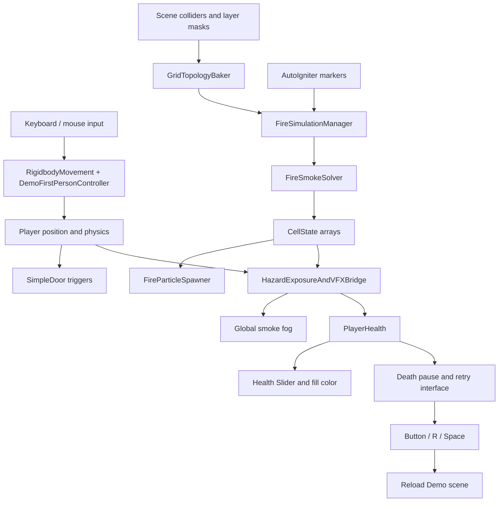
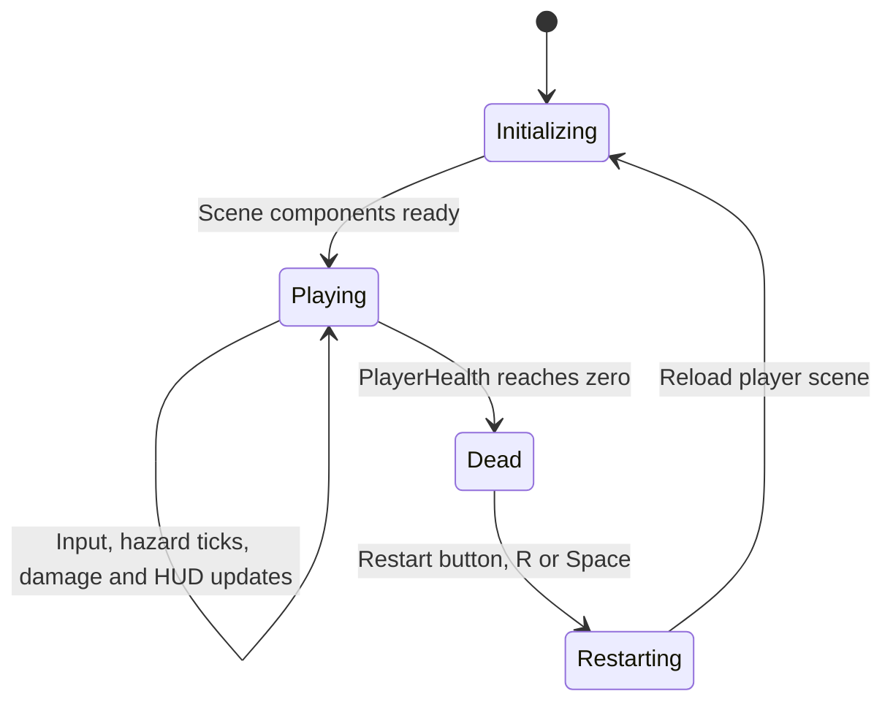

# Smart-Evac: Current System Architecture

Smart-Evac is currently a local Unity first-person fire and smoke simulation prototype. The player explores an office/maze environment, receives heat/smoke damage, sees a health bar change, and can restart after death. This document describes the implemented architecture. Exact fields, equations and saved scene values are in [technical.md](technical.md).

## 1. Runtime boundary

The application runs inside the Unity Editor or a configured Unity player. Current gameplay uses local scene objects, CPU simulation arrays, Unity physics, particle systems, uGUI, and TextMeshPro. It has no connected backend, live AI warning service, or experiment telemetry writer.

The project root is `Disaster Management/`; the playable entry scene is `Assets/ScifiOfficeLite/Scene/Demo.unity`. The recorded Unity version is `6000.3.27f1`, using URP `17.3.0`.



`ClickToIgnite` is an optional source component that can also queue ignitions; the saved Demo scene uses automatic ignition markers.

## 2. Repository and asset organization

```text
disaster-simulation/
├── architecture.md
├── technical.md
├── Disaster Management/                  Unity project root
│   ├── Assets/
│   │   ├── ScifiOfficeLite/Scene/Demo.unity
│   │   ├── ScifiOfficeLite/Scripts/       Demo camera/controller and door scripts
│   │   ├── Scripts/                      Player health, restart UI, movement, doors, NPC source
│   │   ├── RecoveredFire/
│   │   │   ├── My_Scripts/               Grid simulation, ignition, particles, exposure
│   │   │   └── UnityTechnologies/        Required fire/smoke effects and dependencies
│   │   └── TextMesh Pro/                 Committed text resources
│   ├── Packages/                         Package manifest and lockfile
│   └── ProjectSettings/                  Editor, input, rendering and build settings
├── analysis/                             Separate research analytics tooling
├── tools/                                Separate audio/API utilities
└── docs/                                 Research and integration documents
```

The current project uses Siva's scene/player work with the needed fire assets recovered from Avikshith. Original asset GUIDs are preserved through `.meta` files, allowing the Demo scene's fire references to resolve. The former unresolved `Fire_Asset` Git link is replaced by ordinary committed assets in `RecoveredFire`.

Unity-generated caches and local inspection tooling are not required source dependencies. Older README/research documents may still describe the proposed experiment; these two documents describe the current runtime.

## 3. Subsystem responsibilities and ownership

| Subsystem | Implementation | Owns / produces |
| --- | --- | --- |
| Player movement | `RigidbodyMovement`, `ScifiOffice.DemoFirstPersonController` | Input, body velocity, view rotation, crouch |
| Door interaction | `SimpleDoor` | Assigned door's local position in response to player triggers |
| Topology | `GridTopologyBaker`, `CellTopology` | Initial obstacles, fuel and directional permeability |
| Hazard orchestration | `FireSimulationManager` | Grid origin/dimensions, state arrays, tick timer, ignition queue |
| Hazard integration | `FireSmokeSolver`, `SimParameters`, `CellState` | Heat, fuel, fire intensity and two smoke quantities |
| Hazard presentation | `FireParticleSpawner` | Pooled particle instances and per-cell visual activation |
| Player exposure | `HazardExposureAndVFXBridge` | Hazard sampling, damage calculation and global fog updates |
| Player life state | `PlayerHealth` | Authoritative health, death guard, pause state and scene restart |
| Death interface | `HealthGameOverUI` | Missing runtime retry controls and button callback |
| Optional NPC behavior | `NPC_RandomWander` | Random NavMesh destinations where attached and configured |

These components communicate through direct references and method calls. There is no implemented global experiment controller or event bus. `HazardExposureAndVFXBridge.playerHealth` mirrors `PlayerHealth.currentHealth` when a health component is found; it is not a second authority for the HUD/death flow. Without a `PlayerHealth` component, the bridge retains a legacy local-health fallback with no game-over interface.

## 4. Scene composition

The saved Demo scene includes the office/maze geometry, `Player`, `Main Camera`, `FireManager`, three ignition marker objects, HUD canvases, and an EventSystem. Functional associations are:

```text
FireManager
  FireSimulationManager
  FireParticleSpawner -> assigned fire and smoke prefabs
  AutoIgniter -> three marker transforms, delay 1 second

Player
  Rigidbody movement / collision components
  PlayerHealth -> assigned HealthBar Slider
  HazardExposureAndVFXBridge -> grid sampler and damage bridge

Camera/controller object
  DemoFirstPersonController -> playerBody, input mode and mobile-control Canvas

Runtime fallback UI, when no retry panel is assigned
  GameOverCanvas
    GameOverPanel
      GameOverTitle
      RestartHint
      RestartButton
```

This is a component association map, not a complete literal Transform hierarchy. Environment objects and imported prefabs contain additional components. The saved `Mainscene` is not the complete simulation.

## 5. Initialization and gameplay lifecycle

1. Unity loads the scene and resolves package/asset references.
2. `FireSimulationManager.Awake` bakes topology and creates the initial state buffers.
3. `PlayerHealth.Awake` initializes health, finds the Slider fill, and prepares hidden retry UI.
4. Particle startup prewarms fire/smoke pools; exposure startup finds the grid manager and health component and enables fog.
5. `AutoIgniter` schedules marker-based fires. Each processed grid tick updates hazards; per-frame presentation reads the current grid.
6. The bridge samples the player's X/Z position, calculates exposure damage and calls `TakeDamage`.
7. Death reveals restart controls and pauses scaled-time simulation. Restart restores pause-related settings and reloads the scene.



There is no current win/exit-completion state, participant ID, trial counter, or experiment condition selection. R/Space are restart controls after death, not general research trial-reset hotkeys.

## 6. Hazard-to-health sequence

```mermaid
sequenceDiagram
    participant FM as FireSimulationManager
    participant Solver as FireSmokeSolver
    participant VFX as FireParticleSpawner
    participant Bridge as HazardExposureAndVFXBridge
    participant HP as PlayerHealth
    participant UI as Health / retry UI
    FM->>Solver: StepSimulation(read, write, topology, parameters)
    Solver-->>FM: Updated cell states
    FM->>FM: Swap state buffers
    VFX->>FM: GetReadBuffer()
    VFX->>VFX: Activate/reuse particle effects
    Bridge->>FM: SampleHazardAtWorldPosition(player position)
    FM-->>Bridge: Interpolated HazardSample
    Bridge->>Bridge: Calculate heat/smoke damage and fog
    Bridge->>HP: TakeDamage(amount)
    HP->>UI: Update health value and fill color
    alt Health reaches zero
        HP->>HP: IsDead = true; timeScale = 0; pause audio
        HP->>UI: Show retry panel; unlock cursor
        UI->>HP: RetrySimulation()
        HP->>HP: Restore settings and reload scene
    end
```

There is no explicit execution-order attribute coordinating every manager/presentation `Update`; visuals and exposure use whichever current grid buffer is available when they execute.

## 7. Simulation and physics boundaries

The hazard model is a two-dimensional grid projected into a three-dimensional level. Topology comes from collider queries at initialization. The saved Demo wall mask selects no layers, so current grid propagation does not honor scene walls. Fuel queries use Default-layer colliders. Door motion does not update baked topology.

The grid stores upper/lower smoke scalars rather than a 3D fluid volume. Upper smoke diffuses and settles into lower smoke; local exposure changes global fog. These choices support the prototype's gameplay presentation, not a validated physical model.

A layer-10 trigger-damage fallback remains in `PlayerHealth`, but is skipped when the grid damage bridge is present. The previous proposed signage/crowd/hazard layer matrix is not implemented as an authoritative project configuration.

## 8. Research features and external dependencies

The original design proposed AI-vs-crowd evacuation experiments. Those proposals are not the current runtime architecture:

| Proposed capability | Current implementation status |
| --- | --- |
| Safe/trap corridor scoring and assignment | No connected `HazardManager` or weighted-route engine |
| Coordinated crowd fleeing toward traps | Random-wander source exists; coordinated herding is absent |
| Static/dynamic/AI guidance conditions | No connected A/B/C condition controller |
| Gemini-generated warnings and directional speech | Separate utility scripts; no connected runtime API client |
| Gaze and decision-latency measurement | No connected gaze/timing collector |
| CSV trial export and participant progression | Analytics scaffolding exists; no runtime telemetry writer |
| Successful evacuation outcome | No implemented win/exit lifecycle |

Package presence alone does not establish a feature: the manifest includes AI, inference and multiplayer-related packages, but the current gameplay does not implement those services. Playing the implemented scene does not require a Gemini API key.

## 9. Build readiness and known constraints

Desktop Editor play is the current working workflow reported by the project owner. The recorded build scene list is empty. A standalone or Android player needs Demo included in its active build profile, including for scene-index-based restart.

Android also requires matching Editor build modules, input/control configuration, and device testing. No completed APK or Android benchmark is claimed here.

The saved 325,000-cell grid performs significant initialization, solver and particle-scan work on the CPU. Pools can expand beyond their initial size; gizmo rendering adds Editor work. The tick loop drops elapsed remainder rather than catching up, and random smoke uses an uncontrolled random sequence. Performance, reproducibility, obstacle-aware propagation, mobile controls and a win state remain areas for further implementation or validation.
