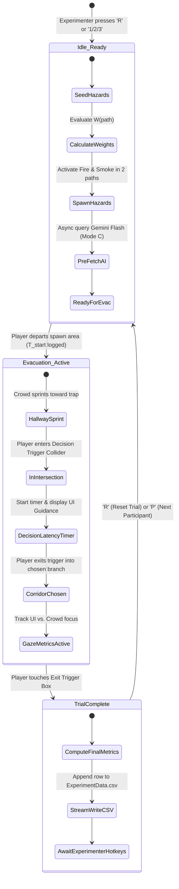
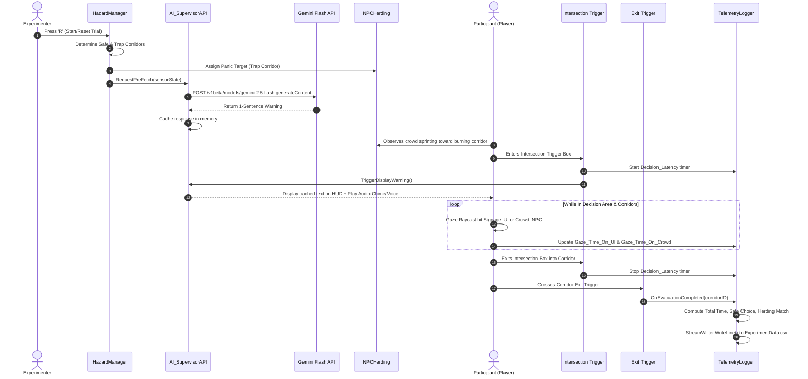

# Smart-Evac: System Architecture Specification

## 1. Executive Summary & Objective

**Smart-Evac** is a 3D first-person experimental testbed engineered in Unity to investigate **Human-AI Trust vs. Social Herding Behavior** in emergency evacuation scenarios. 

In real-world disasters, humans frequently abandon optimal egress routes to follow panicking crowds (social herding), even into deadly traps. Smart-Evac quantifies whether and when participants trust algorithmic guidance (spatial arrows or generative AI HUD warnings) over observable human behavior.

---

## 2. System Architecture Diagram

```mermaid
graph TD
    subgraph Experimenter Controls
        EC[Experimenter Controller Hotkeys<br/>1/2/3: Mode | R: Reset | P: Participant++]
    end

    subgraph Simulation Environment
        HM[HazardManager<br/>Weighted Graph Cost Engine]
        TRAPS[Fire & Smoke Hazard Colliders]
        EXIT_TRIGGERS[Corridor Exit Trigger Colliders]
    end

    subgraph Crowd Simulation
        NPC[NPCHerding System<br/>10-15 NavMeshAgent Capsules]
    end

    subgraph Player & Perception
        PC[GazeAndController<br/>FPS Movement + Center-Raycast]
        RAY[Physics.Raycast<br/>LayerMask: Signage_UI & Crowd_NPC]
        INTER_TRIG[Intersection Decision Trigger Box]
    end

    subgraph Guidance Interfaces
        MODE_A[Mode A: Static EXIT Wall Signs]
        MODE_B[Mode B: Dynamic Glowing Floor Arrows]
        MODE_C[Mode C: Live Gemini AI HUD + Voice/Chime]
    end

    subgraph External & Networking
        GEMINI[Gemini Flash REST API<br/>Async Pre-fetch Pipeline]
    end

    subgraph Analytics & Telemetry
        TL[TelemetryLogger<br/>StreamWriter Engine]
        CSV[(ExperimentData.csv<br/>Project Root)]
    end

    EC -->|Sets Condition & Resets| HM
    EC -->|Increments ID| TL
    HM -->|Spawns Hazards| TRAPS
    HM -->|Feeds Sensor State| GEMINI
    HM -->|Sets Direction Target| MODE_B
    HM -->|Designates Trap Route| NPC
    NPC -->|Navigates Into Trap| TRAPS

    PC -->|Triggers Intersection Box| INTER_TRIG
    INTER_TRIG -->|Activates Cached Alert| MODE_C
    PC -->|Casts Center Ray| RAY
    RAY -->|Accumulates UI Look Time| TL
    RAY -->|Accumulates Crowd Look Time| TL

    PC -->|Reaches Corridor End| EXIT_TRIGGERS
    EXIT_TRIGGERS -->|Logs Metrics Row| TL
    TL -->|Appends Row| CSV
```

---

## 3. Trial State Machine & Lifecycle

Each trial executes a deterministic experimental pipeline to ensure measurement validity:



---

## 4. Subsystem Decomposition & Boundaries

### 4.1 Hazard & State Engine (`HazardManager.cs`)
* **Responsibility**: Maintains the authoritative ground truth of corridor states.
* **Corridor State Enum**: `Left`, `Center`, `Right`.
* **State Selection**:
  * Randomly selects $1$ corridor as `SAFE`.
  * Designates remaining $2$ corridors as `HAZARD` (Fire + Smoke).
* **Cost Function**: Executes graph traversal calculations based on fire and smoke density:
  $$W(\text{path}) = d_{\text{exit}} + (\alpha \cdot H_{\text{fire}}) + (\beta \cdot S_{\text{smoke}})$$
  * Safe path: $H = 0, S = 0 \implies W = d_{\text{exit}}$.
  * Trap paths: High $H$ and $S$ yields penalizing graph weights.
* **Event Dispatching**: Emits `OnHazardLayoutGenerated(HazardState)` to inform the NPC flocking system and UI routers.

### 4.2 Crowd Herding System (`NPCHerding.cs`)
* **Responsibility**: Implements visual panic and social herding behavior.
* **Agent Count**: 10–15 capsules with `NavMeshAgent` and `Crowd_NPC` LayerMask.
* **Behavior Logic**:
  * At trial start, agents are positioned just ahead of the player spawn.
  * Agents bypass safe navigation calculations and intentionally select one of the active fire-trap corridors (or the primary burning exit).
  * High velocity, high acceleration, and slight randomized arrival offsets simulate urgent collective panic.

### 4.3 Guidance & Interface Subsystem
Provides the independent variable conditions toggled by the experimenter:
* **Mode A (Control - Static Signs)**:
  * Static green standard emergency EXIT signs fixed on walls, oriented towards the main burning hallway where the crowd runs.
* **Mode B (Spatial UI - Dynamic Floor Arrows)**:
  * Glowing 3D floor arrows located at the intersection threshold.
  * Dynamically rotate their `transform.rotation` to point down the vector of the designated safe corridor.
* **Mode C (Live Generative AI HUD)**:
  * Screen-space HUD text box linked to `AI_SupervisorAPI.cs`.
  * High-urgency audio chime sound effect + pre-recorded directional voice clips (e.g., *"Warning: Evacuate via Right corridor"*) aligned with the pre-fetched safe corridor.

### 4.4 Networking & Latency Mitigation (`AI_SupervisorAPI.cs`)
* **Zero-Latency Pre-fetch Pattern**:
  * Because emergency decision latency is measured in fractions of a second, awaiting an LLM network trip inside the intersection collider would invalidate `Decision_Latency_Sec`.
  * **Architecture**: The API payload is constructed and dispatched via `UnityWebRequest` immediately upon trial initialization (`HazardManager.Start()` or `ResetTrial()`).
  * The response is cached in memory. When the player steps into the intersection collider, the warning is surfaced with **0 ms UI latency**.
  * **Fallback Circuit Breaker**: If network connectivity drops or the call exceeds 2.5s, an emergency rule-based cached prompt is utilized.

### 4.5 Player Controller & Gaze Perception (`GazeAndController.cs`)
* **Movement**: Lightweight first-person controller (CharacterController or Rigidbody) with mouse look and WASD translation.
* **Physics Raycasting**:
  * Casts an invisible continuous ray from the camera center (`Camera.main.transform.position`, `Camera.main.transform.forward`).
  * Targets dedicated physics layers:
    * Layer: `Signage_UI` $\rightarrow$ Increments `Gaze_Time_On_UI_Sec` via `Time.deltaTime`.
    * Layer: `Crowd_NPC` $\rightarrow$ Increments `Gaze_Time_On_Crowd_Sec` via `Time.deltaTime`.
  * The Raycast layer mask explicitly ignores environment geometry (walls, floors, ceiling) and volumetric smoke colliders to eliminate false positives.

### 4.6 Telemetry & File I/O (`TelemetryLogger.cs`)
* **Responsibility**: Flawlessly record experimental trial runs without introducing garbage collection (GC) pauses or disk I/O latency during gameplay.
* **Output Path**: `Application.dataPath + "/../ExperimentData.csv"` (Project Root). This prevents the Unity Editor from triggering asset database re-imports upon file modification.
* **Thread-safe StreamWriter**: Appends rows synchronously upon the player reaching an exit trigger volume, flushing and closing the stream immediately.

---

## 5. Sequence Diagram: Mode C Evacuation Flow



---

## 6. Physics Layers & LayerMask Strategy

To maximize performance and precision of the gaze tracking engine:

| Layer Index | Layer Name | Physics Raycast Interaction | Purpose |
| :--- | :--- | :--- | :--- |
| **8** | `Signage_UI` | Hit by Gaze Raycast | Static exit signs (Mode A), glowing floor arrows (Mode B). |
| **9** | `Crowd_NPC` | Hit by Gaze Raycast | NavMeshAgent crowd capsules. |
| **10** | `Hazard_Fire` | Ignored by Gaze Raycast | Particle trigger damage/visual colliders. |
| **11** | `Hazard_Smoke` | Ignored by Gaze Raycast | Volumetric particle fog colliders. |
| **12** | `Trigger_Zones` | Ignored by Gaze Raycast | Intersection decision volume and exit goal triggers. |
| **0** | `Default` | Ignored by Gaze Raycast | Hallway architecture (walls, floor, ceiling). |
